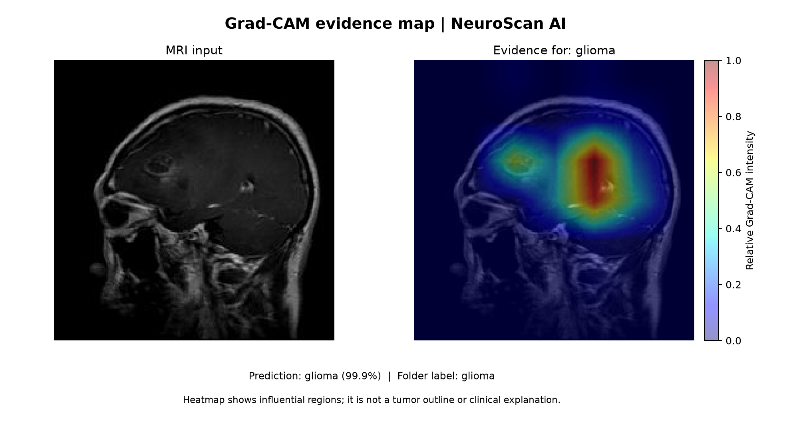

# NeuroScan AI: Brain Tumor MRI Classification

Four-class image classification experiments using the Mendeley Brain Tumor MRI Dataset, version 5 (Glioma, Meningioma, Pituitary, No Tumor). The dataset itself is **not included**; see the dataset DOI in `data_split_manifest.json`.

## Results

All three checkpoints were evaluated on the same 2,414-image held-out Test split. Accuracy and macro-F1 are percentages below; the full per-class precision, recall, F1, and support are in each model's `results/<model>/test_report.json`.

| Model | Best epoch | Best validation loss | Test accuracy | Test macro-F1 | Test loss |
|---|---:|---:|---:|---:|---:|
| Swin-Tiny | 12 | 0.1584 | 90.64% | 90.73% | 0.4121 |
| ResNet-50 | 4 | 0.1611 | 89.85% | 90.05% | 0.3364 |
| ConvNeXt-Tiny | 11 | 0.1265 | 93.16% | 93.15% | 0.2252 |

### Evaluation notes

- The prepared image-level split contains 4,712 Train, 1,003 Validation, and all 2,414 original Test images. Source dataset files were left unchanged.
- Train images matching Test or Validation by exact SHA-256 or pHash distance <= 4 were excluded from Train. The cross-split audit found zero exact or near matches at those thresholds.
- The dataset does not provide patient identifiers, so patient-level separation cannot be confirmed. Near-image filtering may conservatively exclude some distinct but visually similar images.
- The same Test set was evaluated for all three models. Treat the head-to-head comparison as exploratory; do not select/tune a final model based on these repeatedly viewed Test results. A new independent test set would be needed for a confirmatory comparison.
- This is a research classification experiment, not a clinically validated diagnostic system.

## Training setup

- GPU: NVIDIA GeForce RTX 5060 Laptop GPU (8 GB)
- Pretrained weights: ImageNet
- Input size: 224 x 224
- Optimizer/loss: AdamW with class-weighted cross entropy
- Early stopping: validation loss; stop after 8 epochs without at least 0.001 improvement; 100-epoch cap
- Batch size: Swin-Tiny 8; ResNet-50 4; ConvNeXt-Tiny 8
- Best checkpoint selected by lowest validation loss

The `.pth` files in `models/` contain inference-ready model state dictionaries and class metadata; full optimizer/resume states are intentionally omitted to reduce file size. Git LFS is configured for these files.

## Files

- `models/`: best inference checkpoints
- `results/<model>/`: epoch metrics, test report, run summary, training curve, and confusion matrix
- `results/gradcam/`: example Grad-CAM visualization and prediction metadata
- `interpretability/`: reusable Grad-CAM script for all three checkpoints
- `training/`: training script and package versions
- `data_split_manifest.json`: dataset and duplicate-filtering notes

## Inference

Install the packages listed in `training/requirements.txt` in a compatible Python environment, then run:

```powershell
python inference.py --model models/convnext_tiny.pth --image path/to/mri.png
```

Supported model names: `swin_tiny`, `resnet50`, `convnext_tiny`.

## Grad-CAM visualization

The example below uses ConvNeXt-Tiny on a glioma image from the prepared Validation split (not the held-out Test split). The model predicted `glioma` with 99.85% probability.



Generate a Grad-CAM figure for your own MRI image with any of the three checkpoints:

```powershell
python interpretability/gradcam.py --model models/convnext_tiny.pth --image path/to/mri.png --output results/gradcam/my_mri_gradcam.png
```

Use `--target-class glioma` (or `meningioma`, `pituitary`, `notumor`) to visualize evidence for a chosen class instead of the model's predicted class. The adjacent JSON file records the prediction and heatmap target. Grad-CAM is a coarse map of image regions influencing a class score; it is not a tumor boundary, segmentation, or clinically validated explanation.
